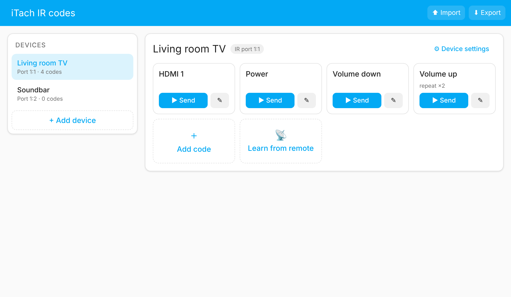
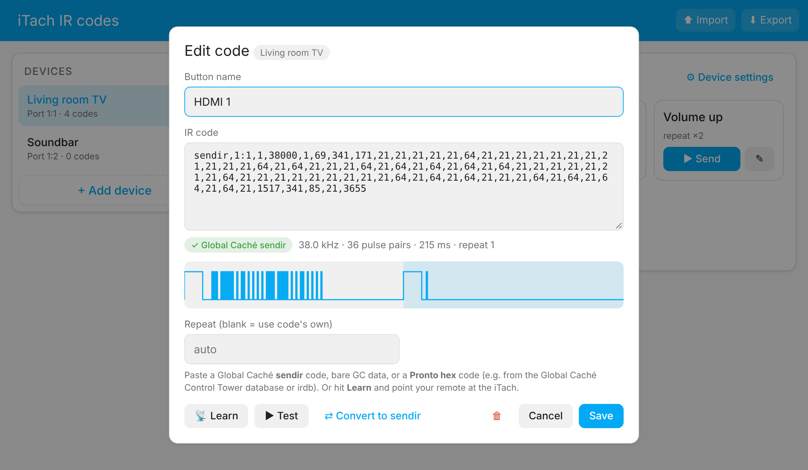

# Global Caché iTach IR for Home Assistant

Control IR devices through a Global Caché **iTach** (IP2IR, WF2IR, Flex IR…), with a **visual code editor** right in the Home Assistant sidebar. Setup is all done in the UI, no YAML needed.



## Features
- **UI setup**: *Settings → Devices & services → Add integration → Global Caché iTach IR*, then type in the IP.
- **"iTach IR" sidebar panel** where you can:
  - add devices (TV, soundbar…) and choose which IR port/emitter each one uses
  - add codes by pasting a **Global Caché `sendir`** string, bare GC data, **Pronto hex**, or a **Flipper Zero** signal
  - **import a whole Flipper Zero `.ir` file** as a device in one go
  - **learn** codes straight from your remote using the iTach's built-in IR learner
  - **test** a code before you save it, and see a live **waveform preview** plus format check
  - convert Pronto to sendir, and import or export everything as JSON
- **A button entity for every code** (grouped into one HA device per IR device), so you can drop them on dashboards or use them in automations
- **Remote entity** that supports `remote.send_command`, `remote.learn_command` and `remote.delete_command`



## Install (HACS)
1. HACS → ⋮ → **Custom repositories** → add this repo's URL, category **Integration**.
2. Install **Global Caché iTach IR** and restart Home Assistant.
3. Settings → Devices & services → **Add integration** → *Global Caché iTach IR*.
4. Open **iTach IR** in the sidebar (admins only).

Tip: give the iTach a fixed IP / DHCP reservation in your router.

## Flipper Zero `.ir` files 🐬
**Whole file:** go to **⬆ Import**, pick the `.ir` file, give the device a name (e.g. *Fireplace*), then click **Import**. Each signal becomes its own button.

**Single code:** in *Add code*, paste just the lines for one signal (the `name:` line is optional):
```
type: parsed
protocol: NEC
address: 01 00 00 00
command: 12 00 00 00
```
Supported: NEC, NECext, NEC42, NEC42ext, Samsung32, RC5, RC5X, RC6, SIRC, SIRC15, SIRC20 and `type: raw` signals. Any other protocol (e.g. Kaseikyo) gets skipped and you'll see which ones. For those, re-learn the button on the Flipper as **RAW**, or just use the panel's 📡 Learn.

## Using it in automations
```yaml
# a saved code
action: remote.send_command
target: { entity_id: remote.lounge_itach }
data:
  device: Living room TV
  command: [Power]

# or just press its button
action: button.press
target: { entity_id: button.living_room_tv_power }

# raw codes work too (no device needed)
action: remote.send_command
target: { entity_id: remote.lounge_itach }
data:
  command: "sendir,1:1,1,38000,1,1,342,171,21,21,..."
```

## Notes
- Codes are stored in `.storage/itach_gc.<entry_id>`, so they're included in HA backups.
- Learning: put the remote 5–15 cm from the front of the iTach. Learning won't work if any port is set to sensor or LED-lighting mode.
- Talks to the iTach on TCP port 4998 (the default).

## Development
```bash
pip install pytest-homeassistant-custom-component home-assistant-frontend
pytest
```
